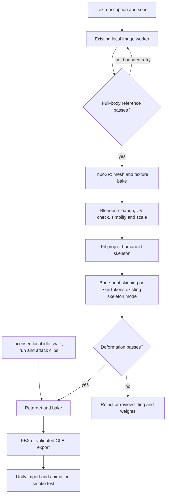
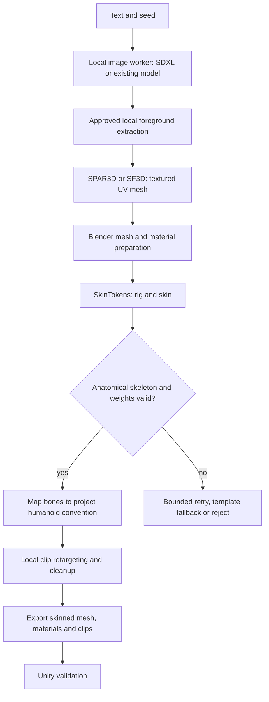
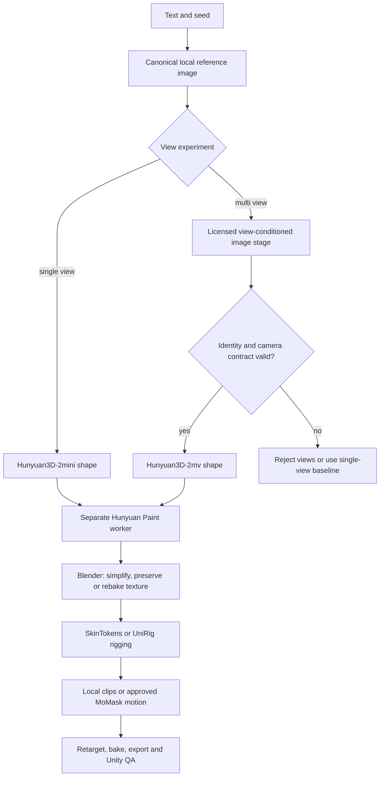
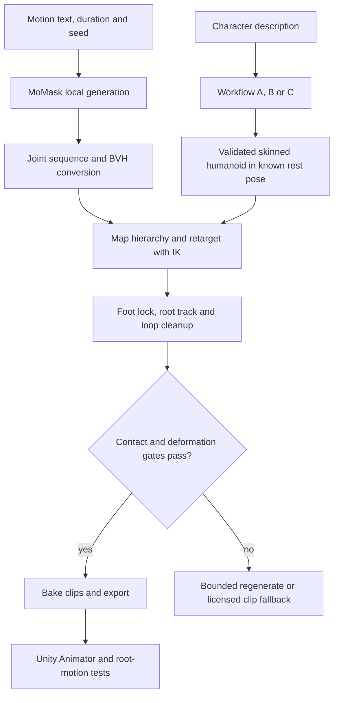
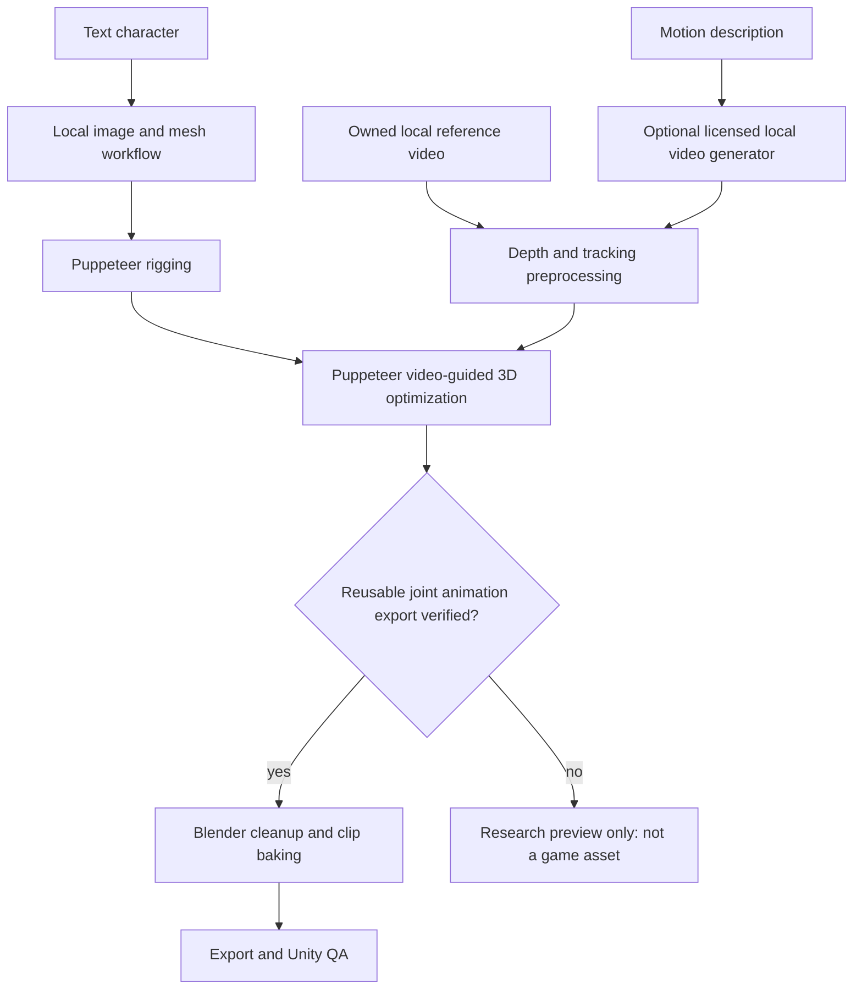
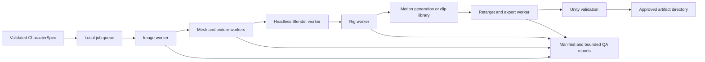

# 0110 — Local text-to-animated-character generation

**Status:** local inference executed; TripoSR + SkinTokens rigged candidate exported, rendered and structurally verified; SF3D Proposal B remains gated  
**Date / sources checked:** 2026-10-11  
**Author:** GitHub Copilot

## Actual execution result — 2026-10-11

**Texture/animation pipeline update:** `automatic_pipeline.py` now includes
automatic smart UV unwrap, 1024² albedo baking, embedded GLB materials and local
MoMask generation of named **Idle / Walk / Run / Jump / Attack** tracks.
`animations.json` controls prompts, seeds, lengths, root-motion policy and loop
intent. Independent GLB reimport measures each clip before the run passes.
The optional, non-gating debug step creates a timestamped folder in `results/`
with numbered reference/cutout images, static model renders, raw and retargeted
motion videos, source assets, reports and a final all-clips video. Existing
exports can also be captured without rerunning generation.
See [AUTOMATION.md](AUTOMATION.md). This is still a research candidate: baked
reconstruction colour is not new texture detail; motion semantics, foot contact,
seamless loops and Unity playback are not certified.

**Motion follow-up:** local MoMask generated a six-second walk; automatic body
mapping and corrected export passed independent GLB playback structural checks.
Arms remain too extended and contact/Unity quality is unverified. See
[MOTION.md](MOTION.md); the earlier isolated walk is now followed by integrated motion stages.

**Follow-up: the fallback now runs unattended from one command.** A fresh run
completed in **205 seconds with zero human interventions**, producing a skinned
28-joint GLB/FBX and scripted previews. See [AUTOMATION.md](AUTOMATION.md) for the
command, stage timings, measured gates and remaining motion/quality limitations.

The follow-up run now has a real model:
[`results/mira-2026-10-11/SK_courier_mira.glb`](results/mira-2026-10-11/SK_courier_mira.glb),
[FBX](results/mira-2026-10-11/SK_courier_mira.fbx),
[Blender scene](results/mira-2026-10-11/courier_mira.blend) and
[rendered preview](results/mira-2026-10-11/preview_front.png).

**Local DreamShaper → TripoSR → SkinTokens → Blender** produced an **18,348-triangle,
34-joint** skinned candidate with an authored deformation smoke-test animation.
This is **not** the original SF3D branch: SF3D weights require account approval
and its Windows native build needs missing tooling. Appearance is vertex colour,
not a UV/PBR texture set. The coarse face/hands and generic rig are not game-ready.
See the [actual attempt report](results/mira-2026-10-11/README.md) for measurements,
deviations, provenance and the authorized shared-store cleanup.

The original blocked preflight and research below are retained as historical
evidence; their “not run” statements describe that earlier attempt, not the
subsequent TripoSR/SkinTokens execution.

## Research question

Can EchoCradle automatically turn a text description into a textured, rigged 3D
character with usable movement clips, entirely through local inference, within
the current machine's memory and disk limits?

## Hypothesis

A composed pipeline is practical for **simple humanoid NPCs**, but there is no
verified single downloadable model here that reliably produces a finished,
animated game character from text. The likely useful decomposition is:

**text → reference image → shape/materials → game-mesh preparation → skeleton +
skinning → motion → retargeting/cleanup → Unity validation.**

Start with one image, one simple humanoid and a small licensed animation library.
Then independently test whether multiview reconstruction improves the mesh and
whether local text-to-motion improves the animation library. Do not change every
stage simultaneously.

## Executive recommendation

1. **First runnable target:** reuse the existing local image worker, compare
   **TripoSR** with **SPAR3D or the existing SF3D candidate**, prepare the mesh in
   Blender, and attach a standard humanoid skeleton. Compare **SkinTokens** with
   the template/bone-heat baseline; keep **UniRig** as an alternative.
2. **First movement target:** locally stored, appropriately licensed clips. This
   is the easiest way to separate character-generation failures from motion-model
   failures. It is an AI-assisted asset pipeline, not a claim that every step is
   generative AI.
3. **First genuinely generated movement target:** **MoMask → BVH → retarget**,
   after checkpoint/dataset/dependency licensing review. Test this first on an
   existing good rig, rather than on an unreliable generated mesh.
4. **Quality branch:** **Hunyuan3D-2mini/2mv + Paint**, only if its license and
   resource footprint are acceptable. **2.1's published combined 29 GB requirement
   does not fit 24 GB** without a separately validated staging/offload setup.
5. **Tripo comparison:** evaluate local **TripoSR**, **TripoSG** and **TripoSF**
  for their distinct stages. Only local inference is in scope.
6. **Do not begin by downloading Iris-3B, SAM 3D Objects, or a video stack.**
   They are either resource-heavy, mismatched to the task, or both.

Model-quality recommendations remain **proposals, not measured successes**.
The implemented pilot and its measured blocked preflight are documented in
[PILOT.md](PILOT.md); its original blocked preflight predates the executed fallback above.
Hero characters, fingers, faces, clothing simulation and arbitrary monsters are
later milestones—not implied by a successful biped demo.

## Setup and constraints

Repository records describe **Windows Server 2022, NVIDIA L4 24 GB, 16 GB system
RAM and Blender 5.2.1**. Current free disk and installed versions must be probed
again before execution; previous free-space figures are not current evidence.

- No inference uploads, cloud fallback, hosted auto-rigger or cloud motion API.
  Internet research and initial approved model downloads are separate from
  inference. After provisioning, test the pipeline with network access disabled.
- Run model stages **sequentially in separate workers**. Exiting a worker is more
  reliable than assuming deleting a Python object releases all VRAM.
- Pause/close other GPU consumers for the benchmark. Measure idle GPU use and
  preserve a safety margin; nominal 24 GB does not mean 24 GB is available.
- **16 GB RAM is a separate constraint.** CPU offload is not free memory and can
  move an out-of-memory failure from GPU to host.
- Native Windows support is evaluated **per stage**, not inferred from CUDA
  support. FlashAttention, sparse convolutions and rasterizers can require builds.
  WSL2 is an optional deployment experiment, not assumed installed or a free fix;
  it consumes additional disk and host RAM.
- Model sizes below are decimal GB and selected checkpoint/repository figures,
  not complete installation budgets. Include encoders, preprocessors, wheels,
  build scratch, caches, working files and pagefile pressure.
- Pin source commits, checkpoint revisions, dependency locks and image workflow
  JSON when running. Today's live `main` URLs are research references, not pins.
- A seed is required, but GPU kernels and dependency changes can prevent bitwise
  replay. Record deterministic settings and tolerances as well as the seed.

## What the requested names actually refer to

**Release test:** a model is considered locally available only when inference
code **and usable trained weights** are released. A paper, demo, plugin, SDK or
“coming soon” repository is insufficient. “Not verified” is not a proof that a
private or later release cannot exist.

| Requested name | Verified identity and stage | Local availability / decision |
|---|---|---|
| **Hunyuan3D** | Tencent family: image/multiview → shape; separate texture/PBR stages | **Open weights on official Hugging Face:** 2, 2mini, 2mv, 2.1, Omni and Part. Local inference under custom Tencent terms, not unrestricted open-source licensing. No turnkey rig + motion implied. [S1–S3] |
| **TripoSR** | Single image → mesh and optional baked texture | Released MIT code/weights; small reconstruction baseline. [S5] |
| **TripoSG** | Single image → detailed shape mesh | Released local code/weights; geometry branch, no complete rig/motion stage. [S6] |
| **TripoSF** | Mesh/point-cloud reconstruction → mesh | Released local VAE/reconstruction workflow, not a text/image character generator. [S10] |
| **TripoSplash** | Exact requested identity **unresolved** | **TripoSplat** is a real candidate, but not a confirmed alias. It produces Gaussian splats, not a conventional skinned character mesh. **TripoSF** is another distinct release. Keep these spellings separate. [S9–S10] |
| **Sam3D** | Meta **SAM 3D Objects** versus **SAM 3D Body** | Objects reconstructs image+mask geometry/appearance/layout; Body estimates a posed human body using MHR. Objects has community **16 GB WSL2** run reports, distinct from its official Linux/≥32 GB recommendation. Neither supplies a complete animated character. [S11] |
| **Supra2** | SupraLabs family; **Supra2-IMG** is text-to-image | Released 256² image front end, not 3D. Intended variant should be confirmed. **SPAR3D is a separate Stability model**, not a spelling correction. [S12–S13] |
| **Iris3B** | Likely **SperidLabs Iris-3B**, a pixel-space image/general-vision model | Local image code/weights released; depth/restoration are separate fine-tunes. Not a mesh, rig or animation generator. Requested spelling association is not author-confirmed. [S14] |

### Local shape and image candidates

Memory numbers are **publisher figures**, unless explicitly identified as file
metadata. They are not measurements or speed predictions for the L4.

| Candidate | Actual input → output | Published resource / platform evidence | Evaluation priority |
|---|---|---|---|
| **Existing local image model / SDXL** | Text → RGB reference | Reuse experiment 0102's deployed model where possible. SDXL base can run without its optional refiner; actual local usage still needs measurement. OpenRAIL++ terms, not MIT. [S15] | First: avoid another large image download |
| **Supra2-IMG** | Text → 256×256 RGB | 104.1M DiT; 0.417 GB checkpoint **plus Flan-T5-Base + VAE**. Script supports Windows/Linux and CPU/CUDA. No numeric inference RAM/VRAM minimum. [S12] | Optional tiny-image baseline; detail may be inadequate |
| **Iris-3B** | Text → roughly 1-megapixel RGB | ~11.95 GB FP32 image checkpoint **plus Qwen3-VL-4B**. Demo's three-model bundle reports ~45 GB GPU; offload ~20 GB peak, not proof that text-only sampling needs exactly that amount. Host-RAM fit unverified. [S14] | Defer on RAM/disk; do not confuse parameter count with full footprint |
| **TripoSR** | One image → mesh, colours; optional baked texture | ~6 GB default VRAM; 1.68 GB checkpoint. Native compilation may be necessary. No rig/motion. [S5] | Small shape baseline |
| **SF3D** | One image → UV-unwrapped textured mesh/material estimates | Existing 0103 candidate; Windows experimental. Revalidate its current package/license rather than inheriting “game-ready” as a character-quality result. [S16] | Reuse if already available |
| **SPAR3D** | One image / point-cloud conditioning → textured UV mesh and material estimates | 7.33 GB main checkpoint; README low-memory section: ~10.5 GB normally, ~7 GB low-VRAM. Also contains older conflicting “6 GB” wording. Windows experimental, VS2022/native builds. [S13] | Textured single-view comparison |
| **TripoSG** | One image → detailed shape mesh, GLB | ≥8 GB CUDA (card says >8 GB); ~7.95 GB model repository + auxiliary models. No complete PBR/rig stage. Native Windows validation not established. [S6] | Geometry branch, not first full pipeline |
| **Hunyuan3D-2mini / 2mv / 2.0** | One or supported multiple views → shape; separate Paint → texture | Family README: 6 GB shape / 16 GB shape+texture; do not certify every variant with one number. Windows support claimed. Selective download required. [S1] | Quality comparison if license accepted |
| **Hunyuan3D-2.1** | Image → shape + PBR texture | Dedicated README: 10 GB shape, 21 GB texture, **29 GB total**. Windows support claimed. Stage splitting/offload requires host-memory verification. [S2] | Defer combined pipeline |
| **TripoSplat** | Image → Gaussian primitives, PLY/SPLAT | ~4.46 GB model repository including an optional encoder; numeric memory minimum not published in examined docs. [S9] | Reference rendering only; not the main mesh pipeline |
| **TripoSF** | Released mesh/point-cloud reconstruction workflow → mesh | ~0.715 GB VAE; ≥12 GB CUDA at 1024³. Released workflow is not a text/image character generator. [S10] | Specialized geometry experiment only |
| **SAM 3D Objects** | Image + mask → geometry, appearance and object layout | Official Linux/≥32 GB VRAM; community 16 GB WSL2 execution reported. Listed checkpoints total **13.106 GB / 12.206 GiB**, not a VRAM minimum. Custom license, gated weights. [S11] | Lower-memory research branch; unmeasured here, disk-blocked |

Hunyuan **Omni** adds pose/point/voxel/box conditioning to mesh generation: an
input skeleton is **not** an output skinning rig. **Part** offers part segmentation
and a released light decomposition model: mesh parts are **not** automatically
articulated characters. Official references to 2.5, 3.0 or Buffalo do not establish
a downloadable replacement; local inference + weights were not verified for
those here. [S3]

**SAM 3D memory distinction:** checkpoint size, peak GPU residency and host RAM
are different quantities. A reported RTX 5070 Ti 16 GB Windows/WSL2 run shows
the official 32 GB recommendation is not a universal lower bound, but is not
native-Windows certification or an L4 measurement; processing took roughly an
hour. Body's guide gives no numeric minimum. Its selected DINOv3 + MHR files
total about 2.805 GB, excluding detector/depth dependencies. [S11]

## One reference image or multiple directions?

**Start with one canonical image.** It is cheaper and directly supported by the
lightweight baselines. Single-image models infer hidden surfaces: the back of a
coat, hair, armour and anatomy are guesses. A plausible front view is not proof
of a coherent character.

### Canonical reference contract

- One full body, neutral **A-pose** (or a fixed T-pose for that experiment), feet
  visible, no cropping, separated arms/legs, minimal perspective and plain ground-
  free background. Include margins and use the model's required framing.
- Simple close-fitting clothing initially. No long cloak, dangling straps,
  held weapon, wings or complex hair; these easily fuse with limbs.
- Soft neutral lighting; avoid cast shadows, dramatic illumination and effects
  that become baked texture. Background removal must not cut fingers/feet.
- Generate one person, not a portrait or a sheet. Reject missing/extra limbs,
  asymmetric anatomy where unintended, and an unusable pose before 3D inference.
- Pose conditioning via a compatible local ControlNet is optional; it introduces
  another checkpoint/license and does not guarantee correct fingers.

Example reference intent: “one stylized adult fantasy courier, full body, neutral
A-pose, simple fitted tunic and boots, short hair, empty hands, isolated on plain
background, neutral lighting, entire feet visible.” Store this exact prompt,
negative prompt where supported, workflow revision and seed.

### Multiview has three different meanings

1. **Independent image prompts:** front/back/side generations can invent different
   clothes and body proportions. Same seed is not a shared 3D identity. A
   turnaround collage also needs separation into correctly labelled images.
2. **Joint/conditioned novel-view synthesis:** one reference produces related
   views with a camera convention. Better experimental input, but still
   hallucinated—not photographs of a real consistent object.
3. **Rendered views of a generated mesh:** perfectly consistent with that mesh,
   useful for texture/QA, but cannot independently prove or recover a missing
   backside feature. Iterating them back into reconstruction is a refinement
   hypothesis, not new ground truth.

**Recommended comparison:** single-image Hunyuan variant versus **2mv**, using
the same canonical character and explicitly documented view construction.
Only a multiview-capable reconstructor consumes multiple input views: TripoSR,
SPAR3D and TripoSG do not become multiview models by passing a list of PNGs.

**Zero123++ / InstantMesh** is a useful research branch: a single image produces
six fixed camera views, then a sparse-view reconstructor produces a mesh. However,
the original Zero123++ repository declares **Apache-2.0 code but CC-BY-NC-4.0
weights**. Do not route commercial-game development through that original weight
release by assuming InstantMesh's code license clears everything. Audit any
alternative/fine-tuned checkpoint separately. [S17]

Zero123++ v1.2 uses azimuths **30°, 90°, 150°, 210°, 270°, 330°**, alternating
elevations **20°/−10°**, and **30° field of view**. These are **not** simply
front/right/back/left orthographic views. Hunyuan2mv has its own view contract;
never relabel the six images as its cardinal views without a validated mapping.
An image identity adapter does not supply calibrated cameras either.

## Rigging and movement are separate problems

A useful conventional output needs mesh vertices/faces, UV/materials, joint
hierarchy, bind/rest transforms, normalized vertex weights, and time-varying
joint transforms. Mesh generation generally supplies only the first group.
MP4, a turntable, a Gaussian splat or per-frame mesh sequence is not equivalent
to a compact rig with reusable clips.

### Local rigging choices

| Method | Capability / resource evidence | Limits and role |
|---|---|---|
| **Standard skeleton + Blender bone heat** | CPU fallback; project-owned biped rest pose and hierarchy; automated skin weights | Skeleton fitting is still necessary. Rigify creates controls from a metarig; it does **not** automatically understand/fill every generated mesh. Template placement needs landmarks, fitting or review. [S18] |
| **SkinTokens / TokenRig** | Mesh → skeleton+skinning; also skin an **existing skeleton**. MIT code/weight metadata. ≥14 GB NVIDIA, ~1.6 GB two-checkpoint bundle. [S19] | Native Windows and 16 GB RAM fit unverified; FlashAttention dependency. Existing-skeleton mode is attractive for consistent Unity retargeting. |
| **UniRig** | Separate predicted skeleton/skin stages; OBJ/FBX/GLB/VRM inputs. ≥8 GB CUDA; MIT code/weight metadata. Current skeleton+skin selected files total ~**5.815 GB**. [S20] | Compiled CUDA dependencies, Windows unverified. Author recommends skeleton correction before skinning. Arbitrary hierarchy needs anatomical mapping before humanoid retargeting. |
| **Puppeteer** | Released mesh rigging + video-guided optimization; Apache-2.0 code/weight metadata. Rig stages quote 4.6/4.2 GB GPU separately. [S21] | Full pipeline is much larger; PartField/Michelangelo and video models add dependencies. Exporter specifies bpy 4.2; Blender 5.2 compatibility unverified. |
| **RigAnything** | Released template-free rigging/checkpoint (~2.345 GB). [S22] | Adobe Research License restricts use to noncommercial academic research/teaching, excluding commercial-product development. Not a default EchoCradle candidate. |

### Local motion choices

| Method | Real output / release evidence | Selection |
|---|---|---|
| **Licensed local clip library** | Known skeleton rotations/root tracks → local retargeting | Production baseline. Record source/terms; an offline library is not permission to call a hosted auto-rigger. |
| **MoMask** | Released pretrained motion models; text → HumanML3D joint data, **BVH**, previews. Generation can skip training dataset downloads. BVH conversion uses template/IK. [S23] | First generative-motion experiment. MIT code; pretrained package and upstream rights require separate clearance. CPU-capable demo documented; numeric memory minimum and native Windows certification not published. |
| **MDM / DiP** | Released text-conditioned joint-motion checkpoints; MDM produces results.npy; DiP generates autoregressive 2-second predictions. [S24] | Alternative. Stock MDM initialization creates SMPL machinery even when final data is joint positions; a skeletal-only deployment needs dependency isolation, not just skipping rendering. |
| **MotionGPT / MotionGPT3** | Released motion-language systems, documented 22-joint NPY outputs. [S25] | Defer: inspected checkpoint metadata says ambiguous `cc`; V3 is gated and does not inherit V1 code permissions automatically. Clarify actual grants. |
| **HY-Motion 1.0 / Lite** | Local text → root/rotation/position NPZ; optional FBX export. Explicit Windows support. Standard minimum 26 GB; Lite 24 GB. Required CLIP-L + **Qwen3-8B**. [S26] | Not first on this machine: Lite uses nominal total VRAM without headroom; host RAM unknown. Custom territorial/output restrictions. No generated detailed fingers or seamless-loop/in-place guarantee. |
| **Puppeteer video-guided stage** | Local reference frames/depth/tracks → 3D animation optimization. [S21] | Interesting later branch, not direct text-to-motion. Must prove skeletal-clip export, not merely render previews. |

**Representation matters:** HumanML3D's common 263-feature representation includes
root state, joint positions, 6D rotations, velocities and contacts. Decoded
22-joint XYZ is not a full SMPL body mesh and does not uniquely determine bone
twist; BVH conversion/IK fills in assumptions. HY-Motion's 201-feature body
representation has 22 body joints and no detailed hand articulation. A larger FBX
template does not imply the model animates every template bone. [S23–S26]

**SAM 3D Body** could supply landmarks/pose for a human fitting experiment, but
does not recover faithful character clothing/textures or a temporal motion clip.
It uses **MHR**, whose license is Apache-2.0, separately from SAM's custom terms.
Using optional SMPL conversion reintroduces the separate SMPL dependency. [S11]

## Proposed workflows

All solid connections below are proposed integration steps unless already
supported by an upstream release. Decision boxes are mandatory QA gates, not
claims that a model always succeeds. Each workflow finishes in the same export
and Unity validation contract.

### A — Smallest practical baseline: single image + reusable movements



**Why first:** lowest added checkpoint footprint, isolates each failure, and
proves animation/export before attempting motion generation. A standard skeleton
makes clip reuse easier than arbitrary predicted bone names.

**Tradeoff:** TripoSR geometry may be blobby and textured detail is not real mesh
detail. Template placement is not magically solved by bone heat. If a landmark
fit cannot pass without human intervention, the experiment must report that as
an automation failure, not silently count the artist's correction as AI success.

### B — Better textured single-image character + learned rigging



**Why:** these reconstruction candidates include useful UV/material preparation;
SkinTokens has released weights and a relatively small checkpoint bundle.

**Risks:** Stability license conditions; Windows native builds; fused fingers,
garments and limbs; arbitrary joint mappings. A GLB containing textures is not
proof of correct anatomy, PBR quality or animation-ready topology. Compare
automatic skeleton prediction against SkinTokens' existing-skeleton skinning
mode so errors in skeleton discovery and weights can be distinguished.

### C — Quality/multiview branch: Hunyuan shape and texture



The view-conditioned image stage is an **integration/license gate**, not a chosen
commercially cleared model. The original Zero123++ release can demonstrate the
technical concept only in a use context permitted by its noncommercial terms;
it is not the default commercial route. A reference-conditioned image-editing
model is another candidate, but identity consistency and correct cameras remain
measured requirements, not guaranteed properties.

**Why:** evaluates hidden-surface consistency and a higher-quality shape/texture
system. **Costs:** view generation and Paint add checkpoints/time; inconsistent
views can make reconstruction worse. Test shape first, then Paint; do not download
an entire multi-variant repository. Hunyuan2mv and multiview **texture synthesis**
are different capabilities.

For 2.1, test shape and texture as isolated stages only after sufficient free
disk/RAM and license approval. Published 10/21 GB individual stage figures are
not proof that unloading between stages succeeds on this host.

### D — Fully generated humanoid movements: text-to-motion branch



Generate movements such as “walk forward naturally,” “stand and breathe,” or
“raise both hands.” Generate basic locomotion first. A prompt involving a weapon
does not create the weapon, socket attachment, hit timing or guaranteed hand
contact. Produce animation events separately from model output.

**Technical benefit:** MoMask's skeletal path does not require evaluation of an
SMPL surface mesh. **License qualification:** this does not automatically clear
checkpoint/training-data/output rights. Initial motion experiments should use
an owned clean rig; combine with generated character geometry only after both
halves pass independently.

No detailed facial animation, lipsync, articulated fingers or quadruped motion
is implied. Keep tails/wings on their own rig/motion systems. A local LLM may
select approved movements or parameters, but must never execute generated scripts.

### E — Exploratory video-guided motion for unusual characters



**Why investigate later:** can potentially bridge visual motion to an existing
character. **Why not first:** occlusion, camera movement, inconsistent video
identity, depth/track errors, optimization cost and extra checkpoints. Puppeteer
adds Video-Depth-Anything and CoTracker3 for this stage. Its example suggestion
to use hosted Jimeng must **not** enter this local workflow. A local video model
is not selected or certified here; begin with an owned reference video to avoid
introducing an entire video generator just to test the bridge.

Do not equate Puppeteer's rigged FBX exporter with verified export of its optimized
motion. Record exactly whether the output is bone animation, vertex animation,
or only rendered frames. Defer this branch under the current disk/RAM budget.

## Shared mesh, rig, animation and export contract

### Mesh preparation

1. Verify complete body, orientation and stable scale; standardize **1 unit = 1 m**.
2. Check topology/components/normals and obvious self-intersections. Do not
   indiscriminately weld a hand to a nearby torso or delete clothing as “noise.”
3. Target **≤30,000 triangles** for this NPC spike, ≤2 material slots and one
   1024² texture set initially. Hero budgets are a different experiment.
4. Decimation changes vertex indices: rig **after** final mesh changes, or
   explicitly transfer weights. Preserve UVs where possible; rebake when remeshing
   changes surface/UV correspondence. Dense isotropic triangles are not joint-
   deformation edge loops; a low face count alone is not retopology success.
5. Audit albedo versus baked lighting, texture seams, sRGB/data maps and PBR
   channel conventions. Generated metallic/roughness is not measured material truth.

### Rig and animation preparation

- One anatomical hierarchy and a stored rest-pose convention. Root/hips are
  distinct; align bone axes, names and bind matrices explicitly.
- Normalize nonnegative skin weights; **≤4 influences per vertex** as the initial
  portability target; no unweighted rendered vertices.
- Test shoulders, elbows, hips, knees and ankles at large bends. Check armpits,
  crotch, garment penetration and disconnected accessories.
- Retarget joint roles, not just identical string names. Resolve body proportions,
  twist bones, arm rest-pose differences and end-effector contacts.
- Choose in-place versus root-motion semantics per clip. Keep source root motion
  for auditing; if converting to in-place, avoid sliding feet while stripping root.
- Bake constraints/IK into bone tracks, choose a declared frame rate (30 fps for
  this spike), trim duplicate endpoints and test loop seams.
- Combat clips additionally need authored/validated contact markers, blend windows
  and event timing. Motion-model plausibility is insufficient for combat logic.

### Output bundle and Unity gate

Deliver `SK_<id>.fbx` **or** a validated `SK_<id>.glb`, material/texture assets,
named clips, a generation manifest and a QA report. Preserve a source `.blend`
only for selected keepers. FBX is the first Unity import path; GLB requires a
compatible installed importer and animation validation—it is not universally
native Unity asset support. GLB embedding can be convenient, not automatically
better than FBX for Animator workflows.

Blender is Z-up while Unity is Y-up; use the exporter's conversion exactly once,
verify orientation and scale after import, and avoid double-transforming bones.
Do not confuse “apply modifiers” on a static mesh with correctly exporting a
skinned armature. Bake intended deformations and inspect the exported result.

- **Humanoid Avatar** only for a valid mapped human hierarchy; otherwise use
  **Generic**, with compatible motion—not forced human mapping for every monster.
- Validate renderer, bone bindings, texture import, animation clip names/durations,
  skin-weight settings, root motion, transitions and several complete playback loops.
- Save/export failure must never replace a working production asset.

## Local automation architecture (proposal, not an implemented API)



Keep the experiment outside production and do not add fake “supported” model
catalog entries. A later orchestrator integration should expose separate jobs,
progress/cancellation, disk reservation and worker teardown, not a blocking
game-thread operation. ComfyUI is useful where a validated graph exists; not every
repository has a maintained compatible node. Direct upstream CLI workers are a
reasonable alternative. MCP controls tools; it is not a model or GPU scheduler.

**Proposed manifest fields:** job/character ID, validated input description,
body class, scale, seed per stage, prompts, workflow/checkpoint/source revisions,
license identifiers/approval, dependency versions, preprocessing/view cameras,
topology/rig/retarget settings, clip provenance, timings, peak GPU/RAM/disk,
artifact hashes and QA outcomes.

Use fixed trusted scripts. Treat text/model output as untrusted data: schema-
validate specifications, constrain paths, reject unexpected asset sizes and never
execute returned code. Retry at most a configured small number (proposed: two);
then reject or mark for review. A review queue is honest failure handling, not an
unlimited hidden manual stage. After provisioning, disallow runtime network
downloads, including automatic text-encoder/background-model fetches.

## Licensing gates: code ≠ weights ≠ dependencies ≠ output

This is a dependency audit plan, **not legal advice or commercial clearance**.

- **TripoSR:** publisher explicitly MIT for code and pretrained model.
  **TripoSG/SkinTokens/UniRig/TripoSplat:** MIT repository/weight metadata, but audit
  all loaded components and any embedded third-party notices.
- Default TripoSG preprocessing downloads **BRIA RMBG-1.4**, with noncommercial
  access/separate commercial arrangements. Prefer generator-provided clean alpha,
  a simple background-removal method, or a separately approved local segmenter;
  replacing it still needs quality validation. [S6]
- **SF3D/SPAR3D:** Stability Community terms, including revenue conditions and
  commercial registration where applicable; inspect the actual agreement and
  attribution/distribution requirements. Do not reduce it to “free model.” [S13,S16]
- **Hunyuan3D / HY-Motion:** custom Tencent grants include geographical/output
  restrictions, notably EU/UK/South Korea exclusions in examined licenses, and
  additional distribution/use conditions. Local inference does not remove them.
- **Supra2-IMG/Iris:** Apache-2.0 metadata/code claims, with their encoders/VAEs
  separately inventoried. **SDXL:** OpenRAIL++ terms and restrictions. A permissive
  image-model license is not a copyright/noninfringement guarantee.
- **Zero123++:** original weights CC-BY-NC-4.0; code Apache-2.0. **RigAnything:**
  academic/noncommercial terms. Neither is a default commercial-game route.
- **MoMask/MDM:** MIT code does not conclusively establish the complete weight
  package, upstream dataset and generated asset rights. HumanML3D/AMASS-derived
  training provenance and any SMPL-family assets need separate review. [S27]
- **SMPL body files** have separate noncommercial/default grants and commercial
  licensing paths. A 22-joint sequence is not itself a redistributed SMPL surface
  file; conversely, joint-only output is not automatically commercially cleared.
- Hosted output terms are not local-weight licenses. This experiment selects only
  locally executable model releases.
- Dataset download permission, code permission and rights to redistribute source
  characters are separate; do not bundle training datasets with the experiment.

## Experiment execution plan

### Phase 0 — Provisioning and reproducibility

Record current GPU/driver/VRAM, RAM/pagefile, free disk, Unity/Blender/Python/CUDA
versions. Inventory installed checkpoints before downloading anything. Select
one variant at a time; calculate an explicit **download + environment + scratch +
output** budget with reserve, and stop if the budget fails. Keep cache paths shared
only where safe to avoid duplicate weights; never delete existing models without
an explicit cleanup decision. Download neither training datasets nor all variants.

Pin revisions and dependency versions once a configuration is selected. Do a
small installation/smoke test before committing to its weights. Record unsupported
Windows dependencies rather than treating Linux instructions as native support.

### Phase 1 — Prove deformation/export without a generator

Use a project-owned simple humanoid mesh and local clips. Validate the shared
skeleton, skinning, FBX import and animation playback. This is the control group.
Then test SkinTokens **existing-skeleton mode** and, separately, full rig prediction
on the same mesh. Compare template/bone heat; test UniRig only if justified.

### Phase 2 — Image → moving generated character

Create three descriptions: a simple courier, a stockier lightly armoured guard,
and a humanoid with a deliberately harder garment. Use three fixed seeds each:
**nine canonical images**. First pilot one courier/one seed to keep costs small.

- Compare TripoSR with **one** textured candidate (SPAR3D or available SF3D).
- Hold image, triangle/texture target, rig method and clips constant.
- Record first-attempt success separately from success after bounded retries.
- Add manual corrections only in a separate measured column; do not merge them
  into unattended success rate.

### Phase 3 — Single-view versus multiview

On the best three pilot references, compare Hunyuan single-view and 2mv only after
license approval. Record view generator/revision, all camera conventions, image
consistency defects and memory footprint. If no permitted coherent-view stage is
available, mark this arm **blocked**, not completed with random independent views.
Compare back/side renders, silhouette consistency and rigging success, not only
front-facing screenshots.

### Phase 4 — Generated motion independently, then combined

After weight/provenance review, generate MoMask motions on the owned control rig:
idle, walk, run, turn and a simple upper-body gesture. Use three motion seeds for
each prompt. Inspect BVH/root/foot contact, then retarget the keepers onto the best
generated characters. Exclude SMPL rendering from this technical path.

Run the same clip through repeated retarget/export/import to check reproducibility.
Only extend to attacks after ordinary locomotion passes. HY-Motion/Puppeteer are
later alternatives, not prerequisites for this phase.

### How to run: current state and verified entry points

**This folder now contains an executable staged Proposal B pilot.** See
[PILOT.md](PILOT.md) for commands, revisions and the measured preflight. It uses
SF3D and SkinTokens full rig prediction, because the generated mesh has no fitted
skeleton. It stops for hash-matched image review and never equates structural rig
QA with validated movement or Unity success. There is no bulk installer.
The upstream demos below describe their real entry points; run them only after
the corresponding isolated environment, approved dependencies and selectively
downloaded checkpoints are prepared. These commands were **not executed here**.
Exact installation locks, source commits and local paths must be recorded during
Phase 0 before the execution experiment can be called reproducible.

From the **TripoSR checkout**, the documented mesh/texture demo is:

```powershell
python run.py inputs/character.png --output-dir out/ --bake-texture --texture-resolution 1024
```

From the **SPAR3D checkout**, the documented textured-mesh entry point is:

```powershell
python run.py inputs/character.png --output-dir out/ --texture-resolution 1024
```

From the **SkinTokens checkout**, after fitting/exporting an existing skeleton:

```powershell
python demo.py --input inputs/character_skeleton.glb --output results/character.glb --use_skeleton --use_transfer
```

The repository's existing rig checker can inspect a prepared asset (substitute
the actual Blender executable and generated asset paths):

```powershell
& "C:\Program Files\Blender Foundation\Blender 5.2\blender.exe" --background --factory-startup --python experiments/three-d-generation/0106-animation-feasibility/src/blender_rig_check.py -- "generated_asset.glb" --export-config report.json
```

That checker is **not** a complete anatomical, retarget or gameplay validator.
For Hunyuan, MoMask and video-guided stages, follow their pinned upstream inference
guides [S1–S2,S23,S21] rather than pretending their Bash/conda demos are already
verified PowerShell workflows. The new preflight and orchestration tests were
run; no inference worker could run with current disk/provisioning blockers.

### Proposed acceptance gates (not measured facts)

| Area | Proposed pass condition |
|---|---|
| Local-only | Provisioned job completes with external network access disabled; no API keys or hosted fallback |
| Basic mesh | Complete recognizable biped, no fused limbs; ≤30k triangles, ≤2 material slots, correct scale/orientation |
| Rig | Valid hierarchy/bind transforms; zero unweighted vertices; normalized ≤4 influences; basic limb bend tests pass |
| Animation | Five useful named clips on correct bones; no severe collapse/penetration; idle/walk loop tested over ≥10 cycles |
| Contact | Evaluate planted-foot drift relative to character height; provisional goal <1% height on stationary contact intervals; annotate exceptions |
| Root and loops | Declared in-place/root-motion behavior; no unintended root jump; measured position/rotation seam deltas |
| Unity | Import, valid Avatar or Generic rig, materials visible; Animator transitions and expected root-motion behavior pass |
| Automation | Initially ≥7/9 Phase-2 assets pass with no manual changes after at most two retries; report first-attempt rate separately |
| Performance | Record cold/warm total time and per-stage load/inference/postprocess; set a latency target only after the pilot |
| Memory/disk | No OOM/paging failure, documented reserve and scratch peak; no leaked GPU worker after completion |
| Rights | Every selected code/weight/dependency/clip has recorded terms and required approval; unresolved grants block shipping |

A successful rigged preview is not proof that the ≥7/9 automation gate is achieved.
Keep failed assets/reports small enough to diagnose, then remove nonessential
intermediates under an explicit retention policy.

## Results

**Implementation + measured blocked preflight. No character, rigging inference,
motion inference or Unity playback was measured in 0110.** Prior experiments contain source
studies and a small Blender API spike; their estimates are not new measurements.

| Measurement | Result |
|---|---|
| End-to-end unattended character success | Not run |
| Geometry / skinning / animation quality | Not run |
| Cold/warm stage latency on L4 | Not measured |
| Peak GPU and host memory | Not measured |
| Free disk at pilot inventory | **5.35 GiB**; live preflight records its own value |
| SF3D + SkinTokens selected checkpoints | **5,643,205,616 bytes / 5.256 GiB**, before image weights, dependencies, caches or scratch |
| Complete environment/checkpoint/scratch size | Not installed; budget fails |
| Pilot preflight | **Blocked**: missing local image/shape/rig environments and weights; insufficient disk; approvals pending |
| Unity import and clip playback | Not run |
| Commercial permission for complete selected stack | Not yet approved |

For execution, log **every attempt**, including stage failure, seed, first/retry
result, triangles/materials, unweighted count, joint mapping defects, contact
drift, deformation score, manual minutes, timing and memory peaks. Capture front,
side, back and several bent poses. Device-level `nvidia-smi` usage is preferable
to nonexistent per-process VRAM figures on this repository's WDDM setup; use
isolated runs and baseline deltas, plus framework peak-memory reports where
available. Record separately reserved versus allocated GPU memory.

### Corrections to earlier experiment conclusions

Leave 0103/0106 intact as historical reports, but do not inherit these claims:

- “MDM/MotionGPT output only SMPL parameters” is too broad: documented HumanML3D
  text paths export joint motion. MDM nevertheless has an initialization dependency
  on SMPL machinery; MoMask provides a clearer skeletal/BVH experiment.
- “SMPL blocks every locally generated human motion” is too broad. Technical
  skeletal-only paths exist; legal clearance remains a separate dependency audit.
- UniRig's older ~4.2 GB usable estimate is superseded by inspected current
  skeleton+skin files totaling ~5.815 GB before environment dependencies.
- “Only manual authoring can reach game quality” was not established by the prior
  API spike. It remains a quality hypothesis to test, not a universal result.
- A UV-textured reconstruction is not automatically animation-ready; template
  rigs are not automatically fitted; GLB is not automatically imported by Unity.
- Do not extrapolate A100/4090/vendor speeds into measured L4 timing.

## Conclusion

**`inconclusive` for end-to-end feasibility; promising research candidates.**

There are sufficient released local components to justify a narrow humanoid
experiment. The most defensible order is **A → B → D**, with **C** as the quality
branch and **E** deferred. The main risks are not just mesh appearance: skeleton
fitting, weights, hidden-surface consistency, motion rights, retargeting, Windows
dependencies and 16 GB host RAM may decide whether the pipeline is unattended.

The project's first deliverable should be **one locally generated simple biped
playing five verified clips in Unity**, with provenance, costs and failures
recorded. Scale to a character roster only after measuring the acceptance gates.

## Next steps

- [ ] Confirm intended identities of TripoSplash, Supra2 and Iris3B.
- [ ] Inventory installed models, current memory and free disk; approve one stack.
- [ ] Clear code/weights/dependencies/clip rights before commercial-development use.
- [ ] Execute Phase 1 control rig/export tests and record Windows compatibility.
- [ ] Run one single-image character pilot, then the nine-image comparison.
- [ ] Evaluate SkinTokens existing-skeleton versus full rigging; compare UniRig if needed.
- [ ] Trial MoMask on an owned rig, then retarget onto generated characters.
- [ ] Trial coherent multiview only when a permitted view-generation stage is available.
- [x] Add staged pilot workers, character description, manifests and source/weight pins.
- [ ] Provision environments and run inference when disk and approvals permit.
- [ ] Promote measured findings to `ideas/`; do not promote research estimates as results.

## Links

- Related idea: [3D orchestration](../../../ideas/model-orchestrator/three-d.md)
- Prior shape selection: [0103](../0103-image-to-3d-selection/README.md)
- Prior rigging/animation study: [0106](../0106-animation-feasibility/README.md)
- Local image selection: [0102](../../image-generation/0102-image-runtime-selection/README.md)
- Residency measurement: [0105](../../benchmarks/0105-vram-probe-residency/README.md)
- Experiment rules: [experiments README](../../README.md)

## Primary sources and evidence register

Checked **2026-10-11**. Links are live research sources; freeze revisions during
execution. Vendor performance/quality statements are not independent benchmarks.
Negative findings mean no usable public release was verified in the examined
sources. Model-card prose can lag file releases: inspect actual files and licenses.

- **S1 — Hunyuan3D 2.x:** [code/variant/platform/memory documentation](https://github.com/Tencent-Hunyuan/Hunyuan3D-2), [2mini weights](https://huggingface.co/tencent/Hunyuan3D-2mini), [2mv weights](https://huggingface.co/tencent/Hunyuan3D-2mv), [license](https://github.com/Tencent-Hunyuan/Hunyuan3D-2/blob/main/LICENSE).
- **S2 — Hunyuan3D 2.1:** [dedicated code and memory requirements](https://github.com/Tencent-Hunyuan/Hunyuan3D-2.1), [weights](https://huggingface.co/tencent/Hunyuan3D-2.1), [license](https://github.com/Tencent-Hunyuan/Hunyuan3D-2.1/blob/main/LICENSE).
- **S3 — Other Hunyuan releases:** [Omni](https://github.com/Tencent-Hunyuan/Hunyuan3D-Omni), [Part and release scope](https://github.com/Tencent-Hunyuan/Hunyuan3D-Part). Conditioning/decomposition are not output rigging.
- **S5 — TripoSR:** [local code/demo/MIT and memory](https://github.com/VAST-AI-Research/TripoSR), [weights/files](https://huggingface.co/stabilityai/TripoSR/tree/main).
- **S6 — TripoSG:** [code and dependencies](https://github.com/VAST-AI-Research/TripoSG), [weights](https://huggingface.co/VAST-AI/TripoSG), [scribble+text variant](https://huggingface.co/VAST-AI/TripoSG-scribble), [BRIA background-model terms](https://huggingface.co/briaai/RMBG-1.4), [third-party notice](https://github.com/VAST-AI-Research/TripoSG/blob/main/NOTICE).
- **S9 — TripoSplat:** [code/output/license](https://github.com/VAST-AI-Research/TripoSplat), [weight files](https://huggingface.co/VAST-AI/TripoSplat/tree/main). This does not establish the identity “TripoSplash.”
- **S10 — TripoSF:** [released reconstruction workflow](https://github.com/VAST-AI-Research/TripoSF), [weights](https://huggingface.co/VAST-AI/TripoSF), [component notice](https://github.com/VAST-AI-Research/TripoSF/blob/main/NOTICE).
- **S11 — SAM and MHR:** [Objects](https://github.com/facebookresearch/sam-3d-objects), [Objects setup](https://github.com/facebookresearch/sam-3d-objects/blob/main/doc/setup.md), [Objects pinned file inventory](https://huggingface.co/api/models/facebook/sam-3d-objects/tree/2e73555018d2741ccd486e56c24fac41155a1dc6/checkpoints), [community 16 GB WSL2 run](https://github.com/facebookresearch/sam-3d-objects/issues/19#issuecomment-3567365457), [Body](https://github.com/facebookresearch/sam-3d-body), [Body setup](https://github.com/facebookresearch/sam-3d-body/blob/main/INSTALL.md), [Body checkpoint/output](https://huggingface.co/facebook/sam-3d-body-dinov3), [MHR](https://github.com/facebookresearch/MHR).
- **S12 — Supra:** [Supra2 text-family example](https://huggingface.co/SupraLabs/Supra2-100M-Base), [Supra2-IMG](https://huggingface.co/SupraLabs/Supra2-IMG), [inference script](https://huggingface.co/SupraLabs/Supra2-IMG/resolve/main/inference.py), [repository metadata/files](https://huggingface.co/api/models/SupraLabs/Supra2-IMG).
- **S13 — SPAR3D:** [code and low-VRAM/Windows guidance](https://github.com/Stability-AI/stable-point-aware-3d), [weights](https://huggingface.co/stabilityai/stable-point-aware-3d), [actual license](https://github.com/Stability-AI/stable-point-aware-3d/blob/main/LICENSE.md).
- **S14 — Iris-3B:** [official code and memory/offload guidance](https://github.com/speridlabs/iris-3b), [official weights](https://huggingface.co/speridlabs/iris-3b), [dated metadata](https://huggingface.co/api/models/speridlabs/iris-3b). Official weight repository created 2026-10-05; a recent release, not an established local benchmark.
- **S15 — SDXL:** [base model card/license](https://huggingface.co/stabilityai/stable-diffusion-xl-base-1.0).
- **S16 — SF3D:** [official repository](https://github.com/Stability-AI/stable-fast-3d), [weights/terms](https://huggingface.co/stabilityai/stable-fast-3d).
- **S17 — Multiview:** [Zero123++ cameras and code/weight licenses](https://github.com/SUDO-AI-3D/zero123plus), [InstantMesh reconstruction](https://github.com/TencentARC/InstantMesh). Audit actual chosen fine-tunes separately.
- **S18 — Rigify/export:** [Rigify introduction and division of responsibilities](https://docs.blender.org/manual/en/4.5/addons/rigging/rigify/introduction.html), [Blender glTF skinning/animation](https://docs.blender.org/manual/en/latest/addons/import_export/scene_gltf2.html).
- **S19 — SkinTokens:** [TokenRig code and existing-skeleton options](https://github.com/VAST-AI-Research/SkinTokens), [checkpoints](https://huggingface.co/VAST-AI/SkinTokens), [FlashAttention platform/build caveats](https://github.com/Dao-AILab/flash-attention#installation-and-features).
- **S20 — UniRig:** [code/release limitations](https://github.com/VAST-AI-Research/UniRig), [checkpoint repository](https://huggingface.co/VAST-AI/UniRig), [skeleton file metadata](https://huggingface.co/api/models/VAST-AI/UniRig/tree/main/skeleton/articulation-xl_quantization_256), [skin file metadata](https://huggingface.co/api/models/VAST-AI/UniRig/tree/main/skin/articulation-xl).
- **S21 — Puppeteer:** [code](https://github.com/Seed3D/Puppeteer), [weights](https://huggingface.co/Seed3D/Puppeteer), [video-guided stage](https://github.com/Seed3D/Puppeteer/blob/main/animation/README.md).
- **S22 — RigAnything:** [code](https://github.com/Isabella98Liu/RigAnything), [weights](https://huggingface.co/Isabellaliu/RigAnything), [research-only license](https://github.com/Isabella98Liu/RigAnything/blob/main/LICENSE.md).
- **S23 — MoMask/HumanML3D:** [generation, BVH and checkpoint links](https://github.com/EricGuo5513/momask-codes), [joint-to-BVH conversion](https://github.com/EricGuo5513/momask-codes/blob/main/visualization/joints2bvh.py), [motion representation](https://github.com/EricGuo5513/HumanML3D#data-structure).
- **S24 — MDM/DiP:** [MDM](https://github.com/GuyTevet/motion-diffusion-model), [DiP](https://github.com/GuyTevet/motion-diffusion-model/blob/main/DiP.md), [MDM initialization](https://github.com/GuyTevet/motion-diffusion-model/blob/main/model/mdm.py), [SMPL construction](https://github.com/GuyTevet/motion-diffusion-model/blob/main/model/rotation2xyz.py).
- **S25 — MotionGPT:** [V1](https://github.com/OpenMotionLab/MotionGPT), [V1 checkpoint metadata](https://huggingface.co/api/models/OpenMotionLab/MotionGPT-base), [V3](https://github.com/OpenMotionLab/MotionGPT3), [V3 gated checkpoint](https://huggingface.co/OpenMotionLab/motiongpt3).
- **S26 — HY-Motion:** [local releases and minimum VRAM](https://github.com/Tencent-Hunyuan/HY-Motion-1.0), [required encoders](https://github.com/Tencent-Hunyuan/HY-Motion-1.0/blob/master/ckpts/README.md), [representation paper](https://arxiv.org/html/2512.23464v1), [license](https://github.com/Tencent-Hunyuan/HY-Motion-1.0/blob/master/License.txt).
- **S27 — Separate body/data terms:** [SMPL model license](https://smpl.is.tue.mpg.de/modellicense.html), [AMASS license](https://amass.is.tue.mpg.de/license.html). Licensing of a deployed combination cannot be inferred just from MIT application code.